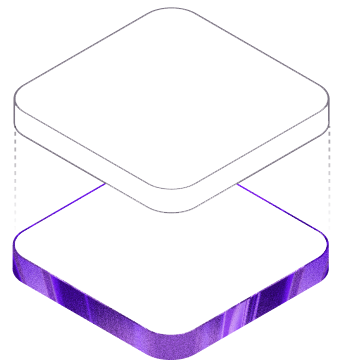

# 🍕 PizzaMath

> **AI-powered math worksheet platform for K–12 students**

[](https://opensource.org/licenses/MIT)
[](https://react.dev)
[](https://www.typescriptlang.org)
[](https://vitejs.dev)
[](https://tailwindcss.com)

---

## 🎯 What is PizzaMath?

PizzaMath is a **subscription-based math worksheet platform** for grades K–12 that helps students practice and track their math skills. Worksheets are aligned to **California Common Core Standards**, making them perfect for California schools and homeschoolers.

### ✨ Core Value

- **Standards-aligned**: Every worksheet maps to specific CA Common Core standards
- **AI-powered**: Request easier, harder, or similar problems on demand
- **Photo-to-worksheet**: Upload photos of handwritten problems to get digitized worksheets
- **Progress tracking**: Track student attempts, scores, and improvement over time
- **Free & accessible**: No account needed to browse; subscription unlocks all features

### 🎓 Who is it for?

| User | What they get |
|------|---------------|
| **Students** | Practice math problems at their level, track progress |
| **Parents** | Easy-to-use worksheets, no prep time needed |
| **Teachers** | Grade-appropriate materials, AI customization |

---

## 📸 Screenshots



---

## 🚀 Installation & Setup

### Prerequisites

- Node.js 20+ and npm
- An Anthropic API key (for Claude AI features)
- Git

### Quick Start

```bash
# Clone the repository
git clone <your-repo-url>
cd pizzamath

# Install dependencies
npm install

# Create .env file (see below for required variables)
cp .env.example .env

# Start the dev server
npm run dev
```

### Environment Variables

Create a `.env` file at the repo root:

```env
# Required
ANTHROPIC_API_KEY=your-anthropic-api-key

# Optional (defaults provided)
BACKEND_PORT=3001
VITE_PORT=5175
CYPRESS_TEST_EMAIL=test@example.com
CYPRESS_TEST_PASSWORD=test123
```

### Development Commands

```bash
npm run dev          # Start Vite frontend (port 5175)
npm run dev:backend  # Start Express backend (port 3001)
npm run dev:all      # Start both (frontend at /pizzamath/)
npm run build        # Production build
npm run test         # Run Vitest unit tests
npm run lint         # ESLint
npm run typecheck    # TypeScript type checking
npm run e2e          # Cypress E2E tests (requires dev server)
```

---

## 🏗️ Architecture Overview

```
┌─────────────────────────────────────────────────────────────┐
│                     Frontend (React 19)                     │
│  ┌─────────────┐  ┌─────────────┐  ┌─────────────────────┐ │
│  │   Browse    │  │ Worksheet   │  │    Generate (AI)     │ │
│  │   Page      │  │   Page      │  │    Page (Claude)    │ │
│  └─────────────┘  └─────────────┘  └─────────────────────┘ │
│                     │                                      │
│  ┌─────────────────┼─────────────────┐                    │
│  │     Navbar      │   Subscription  │                    │
│  │     (Top Bar)   │     Guard       │                    │
│  └─────────────────┴─────────────────┘                    │
└─────────────────────────────────────────────────────────────┘
                           │
                           ▼
┌─────────────────────────────────────────────────────────────┐
│                      Backend (Express)                      │
│  ┌──────────────┐  ┌──────────────┐  ┌─────────────────┐  │
│  │   /worksheets│  │   /progress   │  │    /auth        │  │
│  │   CRUD       │  │   tracking    │  │   login/register│  │
│  └──────────────┘  └──────────────┘  └─────────────────┘  │
│  └──────────────┬─────────────────┘                       │
│                │                                         │
│  ┌─────────────┴─────────────────┐                        │
│  │         SQLite (better-sqlite3)│                        │
│  └───────────────────────────────┘                        │
└─────────────────────────────────────────────────────────────┘
                           │
                           ▼
┌─────────────────────────────────────────────────────────────┐
│                    AI Layer (Claude)                       │
│  ┌─────────────────────────────────────────────┐          │
│  │  Worksheet Generation (text)                │          │
│  │  Photo Upload → Digitize (vision)           │          │
│  │  Generate Similar Problem                  │          │
│  └─────────────────────────────────────────────┘          │
└─────────────────────────────────────────────────────────────┘
```

---

## 📁 Project Structure

```
pizzamath/
├── public/
│   └── logo.svg
│
├── src/
│   ├── main.tsx                    # App entry point
│   ├── App.tsx                     # Router root + auth gate
│   │
│   ├── api/                        # Typed fetch wrappers + Zod schemas
│   │   ├── queryKeys.ts            # React Query keys
│   │   ├── worksheets.ts           # Worksheet CRUD
│   │   ├── progress.ts             # User attempt tracking
│   │   ├── auth.ts                 # Login, register, subscription
│   │   └── claude.ts               # Claude API integration
│   │
│   ├── features/
│   │   ├── auth/
│   │   │   ├── components/         # LoginForm, RegisterForm
│   │   │   ├── hooks/              # useAuth, useSubscriptionGate
│   │   │   └── store.ts            # Zustand auth store
│   │   │
│   │   ├── worksheets/
│   │   │   ├── components/         # WorksheetCard, WorksheetViewer
│   │   │   ├── hooks/              # useWorksheets, useWorksheet
│   │   │   └── index.ts
│   │   │
│   │   ├── progress/
│   │   │   ├── components/         # ProgressEntry, ProgressHistory
│   │   │   ├── hooks/              # useProgress, useProgressMutation
│   │   │   └── index.ts
│   │   │
│   │   └── admin/
│   │       ├── components/         # WorksheetForm, GenerationChat
│   │       ├── hooks/              # useGenerationSession
│   │       └── index.ts
│   │
│   ├── components/                 # Shared UI components
│   │   ├── Navbar/
│   │   │   ├── Navbar.tsx
│   │   │   ├── CategoryDropdown.tsx
│   │   │   ├── SearchBar.tsx
│   │   │   └── AccountMenu.tsx
│   │   └── SubscriptionGuard.tsx
│   │
│   ├── pages/                      # Route-level components
│   │   ├── BrowsePage.tsx
│   │   ├── WorksheetPage.tsx
│   │   ├── AccountPage.tsx
│   │   ├── UsageHistoryPage.tsx
│   │   └── admin/
│   │       ├── AdminPage.tsx
│   │       └── GeneratePage.tsx
│   │
│   ├── stores/                     # Zustand (UI state only)
│   │   └── filterStore.ts
│   │
│   ├── types/                      # Global types
│   │   ├── worksheet.ts
│   │   ├── user.ts
│   │   └── progress.ts
│   │
│   └── utils/
│       ├── cn.ts                  # clsx + tailwind-merge
│       └── logger.ts              # App-wide logger
│
├── server/
│   └── src/
│       ├── index.ts               # Express server entry
│       ├── routes/                # Route handlers
│       ├── middleware/            # Auth, validation
│       └── db.ts                  # SQLite initialization
│
├── cypress/                       # E2E tests
│   └── e2e/
│       ├── login.spec.ts
│       ├── browse.spec.ts
│       └── generate.spec.ts
│
├── docs/                          # Documentation
│   ├── CI.md                      # CI, testing, deployment
│   ├── DOMAIN.md                  # Domain model & roles
│   ├── ARCHITECTURE.md            # Feature details
│   └── USER_GUIDE.md             # End-user product guide
│
├── CLAUDE.md                      # Agent guidance
├── PROJECT_STRUCTURE.md           # Planned layout
├── TECHNICAL_DESIGN.md            # Technical design doc
│
├── package.json
├── vite.config.ts
├── tsconfig.json
├── tailwind.config.ts
└── eslint.config.js
```

---

## 🎨 Tech Stack

### Frontend

| Layer | Technology | Purpose |
|-------|------------|---------|
| UI Framework | [React 19](https://react.dev) | Component-based UI |
| Language | [TypeScript](https://www.typescriptlang.org) | Type safety (strict mode) |
| Bundler | [Vite](https://vitejs.dev) | Dev server + production build |
| Routing | [React Router DOM](https://reactrouter.com) | Client-side routing |
| Server State | [TanStack Query](https://tanstack.com/query) | API data fetching + caching |
| Client State | [Zustand](https://github.com/pmndrs/zustand) | UI state (auth, filters) |
| Forms | [React Hook Form](https://react-hook-form.com) | Controlled form handling |
| Validation | [Zod](https://zod.dev) | Schema validation + type inference |
| Styling | [Tailwind CSS](https://tailwindcss.com) | Utility-first CSS |
| Class Utility | `clsx` + `tailwind-merge` | Conditional class composition |
| AI Integration | [Anthropic SDK](https://github.com/anthropics/anthropic-sdk-typescript) | Claude API (vision + streaming) |
| Math Rendering | [KaTeX](https://katex.org) | LaTeX typesetting |
| Graph Rendering | [Mafs](https://github.com/edemaine/mafs) | Interactive coordinate plane |

### Backend

| Layer | Technology | Purpose |
|-------|------------|---------|
| Server | [Express](https://expressjs.com) | HTTP REST API |
| Language | TypeScript (compiled via `tsx`) | Type-safe server code |
| Database | [better-sqlite3](https://github.com/mapbox/better-sqlite3) | SQLite — persistent local DB |
| Auth | `jsonwebtoken` + `bcryptjs` | JWT signing, password hashing |
| Validation | Zod | Input validation on all routes |
| File Storage | Local disk (`/uploads/`) | User-uploaded worksheet images |
| ID generation | `uuid` | UUIDs for all primary keys |

### Testing

| Layer | Technology | Purpose |
|-------|------------|---------|
| Test Runner | [Vitest](https://vitest.dev) | Fast unit/integration tests |
| DOM Testing | [Testing Library React](https://testing-library.com/docs/react) | User-centric component tests |
| DOM Simulator | `jsdom` | Browser-like environment in Node |
| API Mocking | [MSW](https://mswjs.io) | Network-level mock handlers |
| E2E | [Cypress](https://www.cypress.io) | End-to-end user flows |

---

## 💰 Subscription Model

| Plan | Price | Features |
|------|-------|----------|
| **Free** | $0 | Browse worksheets, view answers |
| **Premium** | $10/month or $100/year | All features including AI generation, progress tracking, admin access |

---

## 📊 Key Features

### 1. Worksheet Browsing
- Filter by category, subcategory, level, and grade
- View worksheet preview and answer key
- Download as PDF or DOC

### 2. AI Worksheet Generation
- Admins use multi-turn Claude chat to generate new worksheets
- Auto-populated metadata (category, level, grade, standards)
- Supports vision: upload photo to digitize handwritten problems

### 3. Progress Tracking
- Record date, score, and comment per attempt
- View history and improvement trends
- Targeted practice suggestions

### 4. Admin Panel
- Create and edit worksheets
- Manage users and subscriptions
- View platform analytics

---

## 🔒 Security

- JWT-based authentication
- Password hashing with bcrypt
- Subscription gate protects premium features
- Input validation on all API routes
- File upload validation (image types only)

---

## 🤝 Contributing

1. Fork the repository
2. Create a feature branch (`git checkout -b feature/AmazingFeature`)
3. Commit your changes (`git commit -m 'Add some AmazingFeature'`)
4. Push to the branch (`git push origin feature/AmazingFeature`)
5. Open a Pull Request

See [`docs/CI.md`](docs/CI.md) for development guidelines and testing instructions.

---

## 📄 License

This project is licensed under the MIT License - see the [LICENSE](LICENSE) file for details.

---

## 📞 Support

For questions, issues, or contributions, please open an issue on GitHub or contact the maintainer.

---

## 🙏 Acknowledgments

- [California Common Core State Standards](https://www.cde.ca.gov/be/cr/cc/c.ccs.asp)
- [Anthropic Claude](https://www.anthropic.com) for AI capabilities
- [React](https://react.dev) team for the amazing UI library
- [Vite](https://vitejs.dev) team for the blazing-fast bundler
